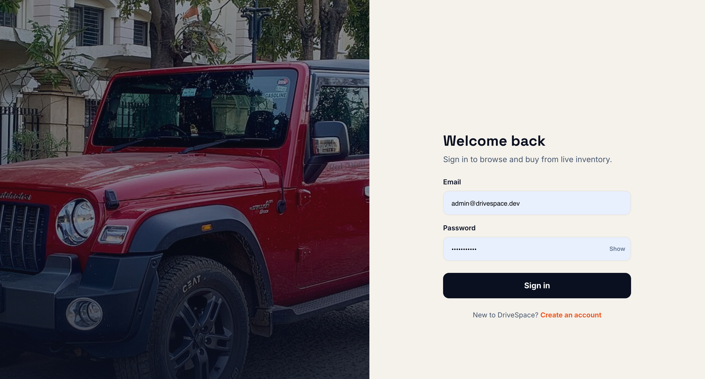
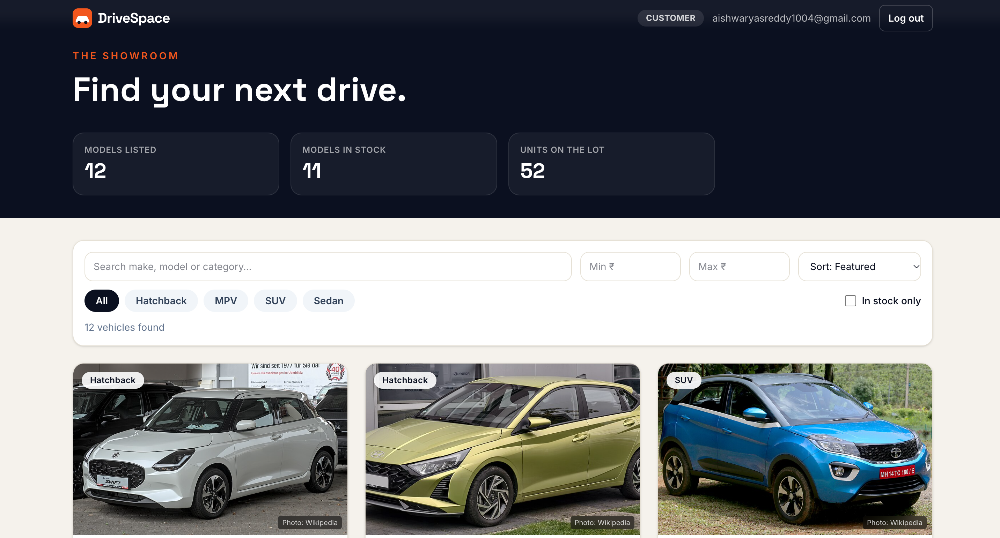
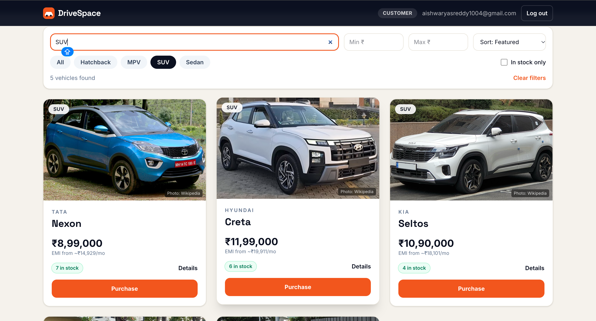
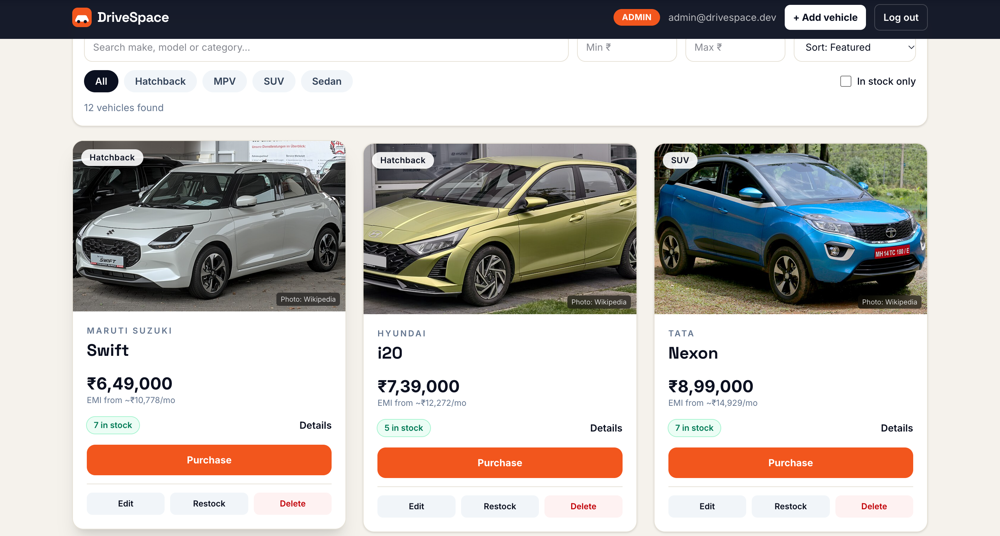
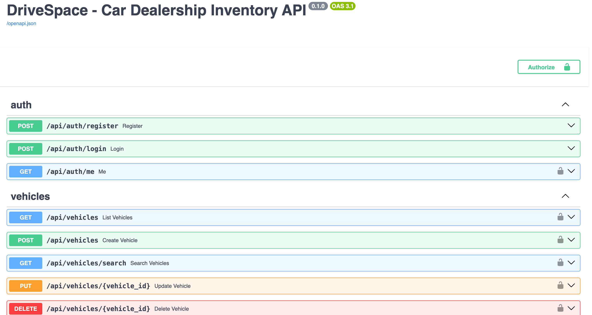

# DriveSpace — Car Dealership Inventory System

A full-stack inventory app for a car dealership, built as a TDD kata. Customers register, browse a live
inventory with real car photos, search and filter it, estimate an EMI and buy a car. Admins add, edit,
restock and delete vehicles from the same UI.

* **Backend:** Python · FastAPI · SQLAlchemy · SQLite (a real on-disk database) · JWT auth · Argon2 password hashing
* **Frontend:** React 19 · TypeScript · Tailwind CSS 4 · Vite
* **Tests:** pytest (72) and Vitest (48) — see [TEST_REPORT.md](TEST_REPORT.md)
* **Why it is built this way:** [docs/DECISIONS.md](docs/DECISIONS.md) — requirement interpretation, trade-offs, known limitations

## What makes it more than a CRUD demo

* **Atomic purchases** — stock check and decrement are one conditional `UPDATE`, so two buyers can never take the last car and stock can never go negative.
* **Real role enforcement** — customers get `403` on create/update/delete/restock at the API, not just hidden buttons. Registration can never grant admin.
* **Real car photos** with attribution — looked up from Wikipedia at runtime; admins can override with their own URL; a drawn silhouette is the fallback.
* **EMI calculator** on every vehicle (pure, unit-tested function).
* **Backend-driven search** — free text, category, price range and in-stock filter all go through `GET /api/vehicles/search` (debounced, stale-response safe).
* **Layered backend** — thin routers, framework-free services, one domain-error handler.

## Run it locally

Prerequisites: Python 3.11+, Node 20+, npm.

### 1. Backend

```bash
cd backend
python3 -m venv .venv && source .venv/bin/activate
pip install -r requirements.txt

# optional but recommended; if unset, a random secret is generated (logins reset on restart)
export JWT_SECRET_KEY="$(python3 -c 'import secrets; print(secrets.token_urlsafe(48))')"

# creates the admin account and 12 demo vehicles (safe to re-run)
python -m app.seed

uvicorn app.main:app --reload
```

API: <http://127.0.0.1:8000> · interactive docs: <http://127.0.0.1:8000/docs>

> **Upgrading from an earlier version of this repo?** The `vehicles` table gained an `image_url` column.
> Delete the old `backend/inventory.db` once, then run `python -m app.seed` again.

### 2. Frontend (second terminal)

```bash
cd frontend
npm install
npm run dev
```

Open <http://localhost:5173>.

### Accounts

| Role | How to get it |
|---|---|
| **Admin** | Created by `python -m app.seed` → `admin@drivespace.dev` / `Admin@12345` (override with `ADMIN_EMAIL` / `ADMIN_PASSWORD`) |
| **Customer** | Click *Create an account* on the login page |

### Configuration

| Variable | Used by | Default |
|---|---|---|
| `JWT_SECRET_KEY` | backend | random per process (with a warning) |
| `DATABASE_URL` | backend | `sqlite:///./inventory.db` |
| `CORS_ORIGINS` | backend | `http://localhost:5173,http://127.0.0.1:5173` |
| `ADMIN_EMAIL`, `ADMIN_PASSWORD` | `python -m app.seed` | `admin@drivespace.dev`, `Admin@12345` |
| `VITE_API_URL` | frontend | `http://127.0.0.1:8000/api` |

## Run the tests

```bash
cd backend  && python -m pytest -q --cov=app          # 72 tests, ~96 % coverage
cd frontend && npm test && npm run lint && npm run build   # 48 tests
```

## API

| Method | Endpoint | Access | Purpose |
|---|---|---|---|
| POST | `/api/auth/register` | public | Create a customer account |
| POST | `/api/auth/login` | public | Exchange email + password for a JWT |
| GET | `/api/auth/me` | user | Current user and role |
| GET | `/api/vehicles` | user | All vehicles (including sold-out) |
| GET | `/api/vehicles/search` | user | `q`, `make`, `model`, `category`, `min_price`, `max_price`, `in_stock` |
| POST | `/api/vehicles` | **admin** | Add a vehicle |
| PUT | `/api/vehicles/{id}` | **admin** | Update a vehicle |
| DELETE | `/api/vehicles/{id}` | **admin** | Delete a vehicle |
| POST | `/api/vehicles/{id}/purchase` | user | Buy one unit (409 when sold out) |
| POST | `/api/vehicles/{id}/restock` | **admin** | Add units `{ "quantity": n }` |

Each vehicle has a unique `id`, `make`, `model`, `category`, `price`, `quantity_in_stock` and an optional `image_url`.

## Project structure

```text
backend/app/
  main.py            app wiring only (CORS, routers, error handler)
  routers/           HTTP layer: auth.py, vehicles.py
  services/          business rules: auth_service.py, vehicle_service.py
  models.py schemas.py errors.py config.py database.py dependencies.py auth.py
  seed.py            first admin + demo inventory
backend/tests/       conftest.py (fresh in-memory DB per test) + 4 test modules
frontend/src/
  api/               typed fetch client + endpoint functions
  hooks/             useSession, useInventory, useDebounced, useToasts
  lib/               emi.ts, format.ts, photo.ts, filters.ts (pure, unit-tested)
  components/        Dashboard, VehicleCard, FilterBar, DetailsDrawer, forms, modals …
docs/DECISIONS.md    decisions, trade-offs, limitations
```

## How TDD shows up in the history

The git log narrates the work (`git log --oneline`):

1. `test: specify admin roles, /me, search, stock and config behaviour (red)` — 14 failing tests + 2 missing modules
2. `feat: admin roles, /me, photo URLs, safer search, config and seed (green)` — 70 passing
3. `refactor: split main.py into routers and services` — same tests, untouched, still green
4. `test: free-text search parameter q …` → `feat: add q …` — a second, smaller red/green cycle
5. `test(frontend): specify EMI maths, price formatting, photo lookup, vehicle card (red)` → `feat(frontend): … (green)`
6. `feat(frontend): rebuild the SPA as DriveSpace …` followed by characterization tests for the finished UI

The earliest commits are the original ChatGPT-assisted first version (auth tests, then the API).

## Screenshots

| | |
|---|---|
| Login |  |
| Customer dashboard with real photos |  |
| Search and filters |  |
| Details drawer with EMI calculator |  |
| Admin view (add / edit / restock / delete) |  |
| FastAPI docs |  |

## My AI Usage

**Tools:** ChatGPT (OpenAI) for the first version, and Claude (Anthropic) for a review-and-improve pass afterwards.
Every commit that involved AI carries a `Co-authored-by:` trailer. The raw conversations are in [PROMPTS.md](PROMPTS.md).

**How I used them**

* **ChatGPT — first version.** Helped with the initial FastAPI endpoints and JWT auth, the pytest fixtures
  and temporary-database setup, debugging the `JWT_SECRET_KEY` import error, and a first React UI and README.
* **Claude — second pass.** I asked it to review the whole project against the kata brief and improve it. It
  - found gaps against the brief: no way to create an admin, no admin UI at all, `POST /api/vehicles` open to every
    customer, search done in the browser instead of through the search endpoint, auth tests writing to the real database;
  - proposed the layered backend (routers / services / domain errors), the `GET /api/auth/me` endpoint, the
    `q` and `in_stock` search parameters and the seed command;
  - wrote the tests first for the new behaviour, then the implementation, then the refactor, committing each stage;
  - rebuilt the React app (admin tools, EMI calculator, real-photo lookup, accessible modals) and wrote the component tests;
  - drafted `docs/DECISIONS.md` and the test report from real command output.

**Reflection**

AI was fastest at boilerplate and at spotting what a brief implies but does not say. It was also confidently
wrong in places: the first version's README claimed a tested, complete system while the admin features had no UI
and the auth tests polluted the real database. The things that actually mattered — whether customers may edit
prices, how to avoid overselling the last car, where the role check must live, how to attribute photos — are
judgement calls, so I wrote them down with their trade-offs in `docs/DECISIONS.md` and verified behaviour by
running the test suites rather than trusting the generated claims. The main lesson: AI speeds up typing, but
reviewing, choosing between trade-offs and being able to explain the result stays my job.

## Photo credits

Car photos are fetched at runtime from Wikipedia / Wikimedia Commons and remain the property of their
contributors under the licences stated on each source page; every photo links back to its article. Prices
and stock levels in the seed data are illustrative.

## Deployment

Not deployed — the project is designed to run locally with the steps above.
